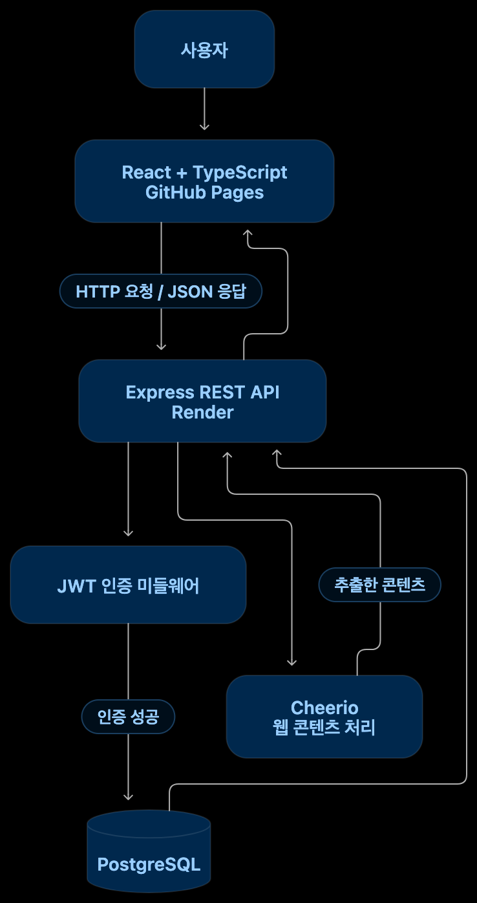

# 읽다 (Read-it)

**읽고 싶은 글을 모으고, 편안하게 이어 읽는 개인 자료실**

읽다(Read-it)는 웹페이지, 텍스트, 파일을 한곳에 저장하고 관리할 수 있는 개인용 웹 애플리케이션입니다. 저장한 자료를 검색하고 분류할 수 있으며, 읽기 진행률과 위치를 기록해 원하는 곳에서 다시 읽을 수 있습니다.

단순한 자료 저장을 넘어, 개인의 읽기 경험을 지속적으로 관리할 수 있는 서비스를 목표로 개발했습니다. 프론트엔드 UI 구현부터 백엔드 API, 사용자 인증, 데이터베이스 연동, 배포까지 전체 개발 과정을 경험하며 웹 애플리케이션의 동작 구조를 이해하고 구현했습니다.

## 🔗 배포 주소

- **웹사이트:** https://dino394.github.io/Read-it-Ilkda-/
- **백엔드 API:** https://read-it-server.onrender.com/
- **GitHub 저장소:** https://github.com/dino394/Read-it-Ilkda-

## ✨ 주요 기능

### 1. 자료 수집 및 관리

- 웹페이지 URL을 통한 콘텐츠 가져오기
- 텍스트 직접 추가
- TXT 및 Markdown 파일 가져오기
- 자료 검색, 필터링 및 정렬
- 자료 수정, 삭제 및 일괄 관리
- 즐겨찾기 및 읽음 상태 관리

### 2. 개인화된 읽기 환경

- 글자 크기 조절
- 다크 모드
- 읽기 위치 및 진행률 저장
- 읽지 않음, 읽는 중, 완독 상태 표시

### 3. 계정 및 데이터 관리

- 회원가입 및 로그인
- 서버 API를 통한 문서 생성, 조회, 수정, 삭제(CRUD)
- 사용자별 문서 데이터 분리
- 브라우저 LocalStorage를 활용한 읽기 관련 상태 관리
- JSON 데이터 백업 및 복원

## 🛠 기술 스택

| 구분 | 기술 |
|---|---|
| Frontend | React, TypeScript, Vite |
| Backend | Node.js, Express |
| Database | PostgreSQL |
| 인증 및 보안 | JWT, bcrypt, 인증 미들웨어, URL 검증 |
| 웹 콘텐츠 처리 | Cheerio |
| 브라우저 저장소 | LocalStorage |
| 배포 | GitHub Pages, Render |
| 버전 관리 | Git, GitHub |

## 🏗 프로젝트 구조

읽다는 프론트엔드와 백엔드를 분리한 구조로 개발했습니다. 프론트엔드는 사용자 인터페이스와 상태 관리를 담당하고, 백엔드는 API 요청 처리와 인증, 데이터베이스 접근을 담당합니다.

Read-it
├── Frontend
│   ├── React
│   ├── TypeScript
│   ├── UI Components
│   ├── Pages
│   └── API Communication
│
└── Backend
    ├── Express API
    ├── Authentication
    │   ├── JWT
    │   └── bcrypt
    ├── URL Validation
    ├── Content Parsing
    │   └── Cheerio
    └── PostgreSQL

## ⚙️ 주요 구현 내용

### REST API와 CRUD

문서 생성, 조회, 수정, 삭제 기능을 API로 구현해 프론트엔드와 백엔드 사이의 데이터 흐름을 연결했습니다. 서버에 저장된 문서를 조회하고 변경 사항이 데이터베이스에 반영되는지 확인했습니다.

### 사용자 인증 및 데이터 분리

회원가입과 로그인 기능을 구현하고, JWT 기반 인증 미들웨어를 통해 보호된 API에 대한 접근을 제어했습니다. 비밀번호는 bcrypt를 사용해 해시 처리하며, 사용자별 문서가 분리되어 조회되는지 테스트했습니다.

### 웹 콘텐츠 가져오기

Cheerio를 활용해 웹페이지의 HTML을 처리하고 콘텐츠를 추출하는 기능을 구현했습니다. URL 검증을 적용해 허용되지 않는 주소에 대한 요청을 제한하도록 구성했습니다.

### 데이터 백업 및 복원

JSON 형식으로 문서 데이터를 내보내고 다시 가져올 수 있도록 구현했습니다. 백업 파일 생성과 복원 후 데이터가 정상적으로 유지되는지 확인했습니다.

## 🧪 테스트 및 문제 해결

개발과 배포 과정에서 발생한 문제를 확인하고 수정하며 서비스의 주요 기능을 검증했습니다.

- **빌드 오류:** TypeScript 타입 오류와 모듈 import 문제를 수정하고 프로덕션 빌드를 확인했습니다.
- **CORS 오류:** 프론트엔드 배포 주소와 백엔드의 허용 출처 설정을 확인해 API 연결 문제를 해결했습니다.
- **배포 환경 설정:** GitHub Pages와 Render 환경에서 프론트엔드 및 백엔드가 연결되도록 구성했습니다.
- **인증 테스트:** 비로그인 API 접근이 거부되는지, 잘못된 비밀번호 입력 시 오류가 정상적으로 처리되는지 확인했습니다.
- **데이터 무결성 확인:** 새로고침 후 데이터 유지, 사용자별 문서 분리, JSON 백업 및 복원을 테스트했습니다.

## 📚 개발을 통해 배운 점

- React와 TypeScript를 이용한 프론트엔드 구조화
- REST API를 통한 프론트엔드와 백엔드 간 통신
- Express 미들웨어를 활용한 인증 처리
- PostgreSQL을 이용한 서버 데이터 관리
- CORS와 환경변수를 포함한 배포 환경 설정
- 오류 로그를 바탕으로 원인을 좁혀 가는 디버깅 과정

## 🚀 향후 개선 계획

- API 및 인증 관련 자동화 테스트 추가
- 입력값 검증과 예외 처리 강화
- 보안 설정 및 배포 환경 점검
- 반응형 UI와 접근성 개선
- 서비스 운영을 고려한 로깅 및 모니터링 추가
